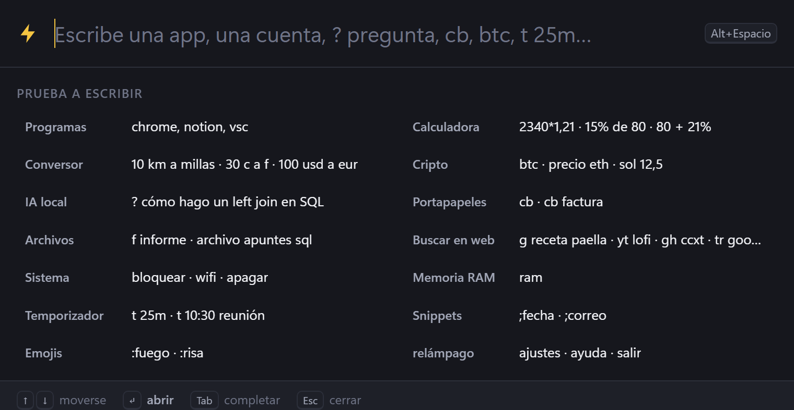
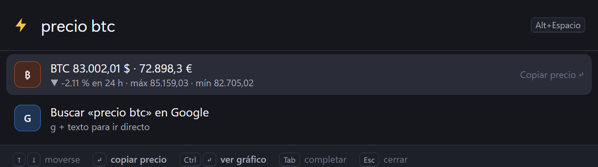
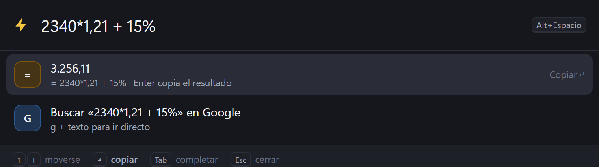
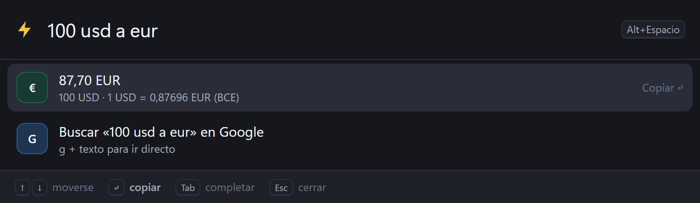
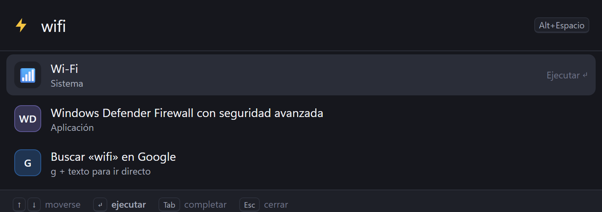

# ⚡ relámpago

**Lanzador universal para Windows, en español.** Pulsas <kbd>Alt</kbd>+<kbd>Espacio</kbd> desde cualquier
programa, escribes, y pasa. Como Spotlight o Raycast, pero con IA local, cripto en directo e historial del
portapapeles, sin cuentas ni suscripciones.



## Lo que hace

| Escribe… | …y pasa esto |
|---|---|
| `chrome` · `notion` · `vsc` | Abre cualquier programa del menú Inicio (también de la Store). **Aprende** cuáles usas más y los sube. |
| `2340*1,21` · `15% de 80` · `80 + 21%` | Calculadora con coma decimal y porcentajes a la española. Enter copia el resultado. |
| `10 km a millas` · `30 c a f` · `5 gb en mb` | Conversor de longitud, peso, volumen, datos, tiempo, velocidad, área y temperatura. |
| `100 usd a eur` | Divisas con el cambio oficial del BCE. |
| `btc` · `precio eth` · `sol 12,5` | Precio en directo (Binance) en $ y €, variación 24 h. Ctrl+Enter abre el gráfico en TradingView. |
| `? cómo hago un left join` | Pregunta a **tu IA local** (Ollama): sin internet, gratis, privado. Respuesta en streaming, recuerda la conversación. |
| `cb` · `cb factura` | **Historial del portapapeles**. Enter lo pega directamente en la ventana donde estabas. |
| `f informe` | Busca archivos en Escritorio, Documentos, Descargas… (y las carpetas que añadas). Ctrl+Enter lo muestra en el Explorador. |
| `ram` | Qué se está comiendo la memoria, agrupado por programa (30 procesos de Chrome = 1 línea). Enter lo cierra. |
| `t 25m pomodoro` · `t 10:30 reunión` | Temporizadores y alarmas con notificación de Windows. `t` lista y cancela. |
| `g …` · `yt …` · `gh …` · `wiki …` · `tr …` | Búsqueda directa en Google, YouTube, GitHub, Wikipedia, traductor, RAE, Amazon, Stack Overflow… |
| `bloquear` · `suspender` · `wifi` · `bluetooth` | Controles del sistema y atajos a Configuración. Apagar/reiniciar piden un segundo Enter. |
| `;fecha` · `;correo` · `;uuid` | *Snippets*: textos guardados que se pegan al instante. |
| `:fuego` · `:ok` · `:risa` | Emojis por su nombre en español. |

<table><tr>
<td></td>
<td></td>
</tr><tr>
<td></td>
<td></td>
</tr></table>

## Teclado

<kbd>↑</kbd> <kbd>↓</kbd> moverse · <kbd>Enter</kbd> acción · <kbd>Ctrl</kbd>+<kbd>Enter</kbd> acción alternativa ·
<kbd>Tab</kbd> completar · <kbd>Esc</kbd> borrar / cerrar · <kbd>RePág</kbd> <kbd>AvPág</kbd> desplazar la respuesta de la IA.

## Instalar

Necesitas **Windows 10/11** y [uv](https://docs.astral.sh/uv/) (o Python 3.11+).

```bash
uv tool install git+https://github.com/tiopabli1604-star/relampago
relampago --inicio        # que arranque solo al encender el PC (opcional)
relampago                 # arrancarlo ahora → pulsa Alt+Espacio
```

Para la IA local instala [Ollama](https://ollama.com) y un modelo, por ejemplo `ollama pull qwen2.5:7b`.

## Configuración

Escribe `ajustes` en relámpago para abrir `~/.relampago/config.json`:

```json
{
  "atajo": "alt+space",
  "modelo_ia": "qwen2.5-coder:7b",
  "carpetas": ["D:\\Proyectos"],
  "portapapeles": true,
  "snippets": { "correo": "yo@ejemplo.com", "firma": "Un saludo,\nYo" }
}
```

Después escribe `recargar`. Si <kbd>Alt</kbd>+<kbd>Espacio</kbd> ya lo usa otro programa (p. ej. PowerToys Run),
cambia el `atajo`, por ejemplo a `"ctrl+space"` o `"win+alt+space"`.

## Privacidad

- Todo se queda en tu PC (`~/.relampago`). Las únicas llamadas a internet son las que pides: precios
  (Binance), divisas (BCE) y las búsquedas web.
- La IA es **local** (Ollama): tus preguntas no salen del ordenador.
- El historial del portapapeles **no guarda** lo que copian los gestores de contraseñas (KeePass,
  Bitwarden, 1Password…): respeta la marca estándar de Windows que ellos ponen. Puedes desactivarlo
  con `"portapapeles": false` o borrarlo desde `cb`.

## Cómo está hecho

- **Python** + [pywebview](https://pywebview.flowrl.com/) (ventana nativa con el motor Edge de Windows)
  y `psutil`. El resto — atajo global, portapapeles, pegado en la ventana anterior, notificaciones,
  esquinas de Windows 11 — es `ctypes` directo contra la API de Windows, sin más dependencias.
- **Plugins**: cada función es una clase pequeña en `src/relampago/plugins/`. Un plugin devuelve
  resultados al instante y puede **empujar** resultados tardíos (red, IA) sin bloquear la escritura;
  si ya escribiste otra cosa, la respuesta vieja se descarta.
- **Búsqueda aproximada** sin tildes: prefijos, inicio de palabra, iniciales (`vsc` → Visual Studio
  Code) y subsecuencias por palabras, más un extra por frecuencia y recencia de uso.
- La calculadora **no usa `eval`**: recorre el árbol sintáctico y solo permite números y operaciones.

### Crear un plugin

```python
from relampago.nucleo import Plugin, Resultado

class Dado(Plugin):
    nombre = "dado"
    titulo = "Dado"
    prefijos = ("dado",)
    ejemplo = "dado"

    def buscar(self, consulta, empujar):
        import random
        n = random.randint(1, 6)
        return [Resultado(f"🎲 {n}", "Enter copia", "🎲", copiar=str(n), puntuacion=100)]
```

Añádelo a `TODOS` en `plugins/__init__.py`.

## Desarrollo

```bash
uv sync
uv run pytest                    # 54 tests
uv run relampago --navegador     # la misma interfaz en el navegador, útil para desarrollar
```

## Licencia

MIT
